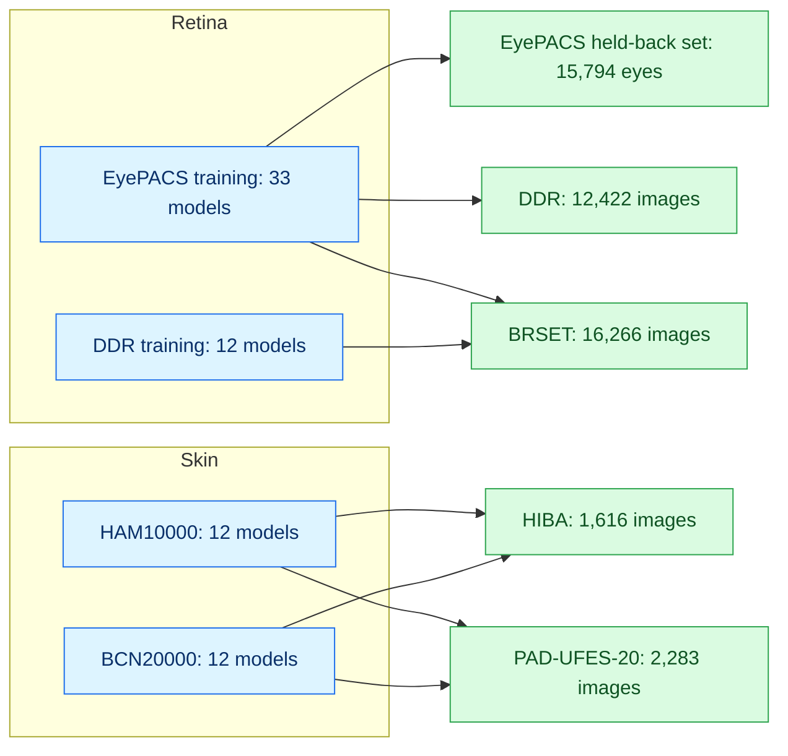

# A second AI reader catches more missed disease when trained on different data

**Does pairing two AI screening systems actually catch more disease, or do they just miss the same patients?**

Avnish A. Deobhakta · Richard B. Rosen · Tak Yee Tania Tai · James C. Tsai · Alon Harris · Louis Pasquale

*New York Eye and Ear Infirmary of Mount Sinai · Icahn School of Medicine at Mount Sinai*

---

## In one paragraph

Screening programmes are starting to put a second AI system behind the first, on the assumption that it gives an independent opinion. We tested that with **69 models** in **diabetic retinopathy and skin cancer** across **five populations**. Every comparison was made at **equal referral volume**, so the pair can't win simply by referring more people. A second reader cut missed sight-threatening and malignant disease in every population, but less than independence would predict, because systems miss the same cases far more often than chance. **What mattered most was training data:** in pre-registered tests in both domains, systems trained on different data shared fewer missed cases than systems that differed only in design.

## Headline results

| Population | Outcome | Reduction in missed disease (95% CI) | Compared with |
|:--|:--|:--:|:--|
| EyePACS (US screening) | Proliferative DR | **22%** (12% to 34%) | better system of each pair |
| DDR (Chinese hospitals) | Proliferative DR | **27%** (19% to 40%) | deployed system |
| BRSET (Brazil) | Severe DR | **25%** (20% to 31%) | deployed system |
| HIBA (Argentina) | Any skin cancer | **17%** (12% to 22%) | deployed system |
| PAD-UFES-20 (Brazil, smartphone) | Any skin cancer | **10%** (7% to 12%) | deployed system |

> [!TIP]
> **Different data beats different design.** Pairs trained on different collections shared fewer missed cases than pairs trained on the same one. In BRSET the primary contrast was 0.39 (0.32 to 0.46) for referable DR; in HIBA it was 0.44 (0.23 to 0.75) for melanoma.

> [!NOTE]
> **It survives pricing false referrals** (secondary, post hoc). When every strategy picks its own referral volume, pairing beats the better system in EyePACS and DDR for any programme willing to accept more than about 50 false referrals to save one eye. In BRSET, where disease is rarest, it helps against a system chosen without hindsight, but not against the better of the two.

## Study design

**Three rules held for every comparison**
1. **Specified in advance.** Each confirmatory plan was written, dated and hashed before its data were opened, and each test set was scored once.
2. **Equal referral volume.** A pair refers exactly as many cases as one system, so any benefit comes from choosing better whom to refer.
3. **Honest uncertainty.** Bootstrap intervals resample patients (or image groups), and systems themselves wherever pairs share members.

## What's in here

| Folder | Contents |
|:--|:--|
| [`notebooks/01_eyepacs/`](notebooks/01_eyepacs) | Splits, training of the 33 EyePACS models, the held-back test set, the **primary analysis**, partner choice, exploratory and harm-weighted analyses |
| [`notebooks/02_ddr/`](notebooks/02_ddr) | DDR intake, inference, the confirmatory DDR analysis, training of the 12 DDR models |
| [`notebooks/03_brset/`](notebooks/03_brset) | BRSET download, inference, the confirmatory analysis and follow-ups |
| [`notebooks/04_skin/`](notebooks/04_skin) | Skin intake, training of the 24 skin models, the confirmatory analysis, follow-ups and the harm-weighted secondary analysis |
| [`notebooks/05_similarity/`](notebooks/05_similarity) | Degradation fingerprints, and predicting shared misses from the models |
| [`notebooks/06_figures/`](notebooks/06_figures) | Figure notebooks |
| [`plans_and_results/`](plans_and_results) | Dated plans, locks with their hashes, aggregate results |

## Where each result comes from

| Result | Notebook |
|:--|:--|
| **Primary:** net severe misses against the better member, EyePACS | [`09_lock_v3_and_fresh_eval`](notebooks/01_eyepacs/09_lock_v3_and_fresh_eval.ipynb) |
| DDR results, and the copied 25% referral share | [`DDR_analysis_v5_1`](notebooks/02_ddr/DDR_analysis_v5_1.ipynb) |
| BRSET results, training-data effect, sibling test | [`BRSET_analysis_v6`](notebooks/03_brset/BRSET_analysis_v6.ipynb), [`BRSET_exploratory`](notebooks/03_brset/BRSET_exploratory.ipynb) |
| Skin results, training-data effect, fingerprint test | [`DERM_analysis`](notebooks/04_skin/DERM_analysis.ipynb) |
| Choosing a partner by error overlap | [`CONFIRM_lock_v4`](notebooks/01_eyepacs/CONFIRM_lock_v4.ipynb), with [`EXPLORE_frontier_v2`](notebooks/01_eyepacs/EXPLORE_frontier_v2.ipynb) and [`EXPLORE_buying_rule_v2`](notebooks/01_eyepacs/EXPLORE_buying_rule_v2.ipynb) |
| Starting weights against architecture | [`STARTING_WEIGHTS_part2`](notebooks/01_eyepacs/STARTING_WEIGHTS_part2.ipynb) |
| Sibling agreement and local partner choice | [`SIBLINGS_detector`](notebooks/01_eyepacs/SIBLINGS_detector.ipynb), [`PARTNER_choice_calibration`](notebooks/01_eyepacs/PARTNER_choice_calibration.ipynb), [`ENRICHED_calibration`](notebooks/01_eyepacs/ENRICHED_calibration.ipynb) |
| Degradation fingerprints (22-model zoo) | [`BALLISTICS_fullrecipe`](notebooks/05_similarity/BALLISTICS_fullrecipe.ipynb) and its pilots |
| Floor of shared misses among EyePACS models | [`PREDICT_from_models_v2`](notebooks/05_similarity/PREDICT_from_models_v2.ipynb) |
| Harm-weighted analysis and the two bounds | [`18_literature_weighted_secondary_v2`](notebooks/01_eyepacs/18_literature_weighted_secondary_v2.ipynb), [`18b_two_bounds_v2`](notebooks/01_eyepacs/18b_two_bounds_v2.ipynb) |
| Retina: operating characteristics, case influence, CNN against transformer | [`19_reviewer_checks_v2`](notebooks/01_eyepacs/19_reviewer_checks_v2.ipynb) |
| Skin: priced false referrals and the two bounds, referring any case either system flags, operating characteristics, case influence, CNN against transformer | [`20_derm_secondary_v4`](notebooks/04_skin/20_derm_secondary_v4.ipynb) |

## Notes

- `TRAIN_ddr_v2_pilot` is the full training run of the 12 DDR-trained models; the name is kept as run.
- `03b_aptos_inference_allseeds_v2` made predictions on APTOS 2019. APTOS was not analysed because it releases no patient identifiers, so patient-level analysis is impossible.
- Figures 1, 2 and 7 were drawn outside the notebooks from the results files in `plans_and_results/`. Figures 3 to 6 and Supplementary Figure 9 come from `06_figures/FIGURES_final_v4`, Supplementary Figure 8 from `06_figures/FIGURES_final`, and the BRSET panels from `03_brset/FIGURES_brset`.
- `20_derm_secondary` was run as versions 2 to 4 with the same code and seed. Version 4 is published because it reproduces every number of the earlier versions and adds intervals for the union costs; it also chooses the better member on the outcome each row reports, and prints the earlier definition alongside.
- Notebook 18's introduction was edited after the run to remove a reference to an unrelated study's notebook; no code, outputs or results were changed.

> [!IMPORTANT]
> **BRSET** is available to credentialed users from [PhysioNet](https://physionet.org/content/brazilian-ophthalmological/). No BRSET record-level data are in this repository, and only aggregate results are shown. Credentialed users can regenerate the predictions with these notebooks.

## Data

| Dataset | Source |
|:--|:--|
| EyePACS | Kaggle Diabetic Retinopathy Detection |
| DDR | Li et al., *Information Sciences* 2019 |
| BRSET | PhysioNet (credentialed access) |
| HAM10000, BCN20000, HIBA | ISIC Archive |
| PAD-UFES-20 | Mendeley Data |

Per-image predictions for the openly available test sets, the split files and the model checkpoints are archived at Zenodo: *DOI to be added*.

## Citation

*Citation to be added on publication.*

Built and run on Google Colab. Every notebook is shown exactly as it was run.

## Review revisions (October 2026)

Analyses added in response to four rounds of pre-submission review. All are post hoc and exploratory unless the manuscript says otherwise; the pooled-training comparison (26) had its plan and predictions dated before training. Every notebook is published as it was run.

| Notebook | What it does |
|---|---|
| [`21a`](notebooks/07_review_revisions/21a_retina_revisions_c1.ipynb), [`21b`](notebooks/07_review_revisions/21b_retina_revisions_c1.ipynb) | Retina: patient-level summaries, full-procedure and corrected model bootstraps, fixed-anchor source comparison, out-of-sample harm tuning, partner choice with patients kept apart |
| [`22`](notebooks/07_review_revisions/22_skin_revisions_c1.ipynb) | Skin: the same checks, lesion-level summaries |
| [`23`](notebooks/07_review_revisions/23_regret_c1.ipynb) | Regret of picking one system versus pairing |
| [`24`](notebooks/07_review_revisions/24_adaptive_rule_c1.ipynb) | Local pilot, then pick or pair (original DeLong version) |
| [`25`](notebooks/07_review_revisions/25_deployment_c1.ipynb) | Categorical outputs, a fixed background partner, more than two systems |
| [`26`](notebooks/07_review_revisions/26_pooled_training_c1.ipynb) | Pooled training versus pairing (plan dated before training) |
| [`27`](notebooks/07_review_revisions/27_figures_c1.ipynb), [`28`](notebooks/07_review_revisions/28_supp_figures_c1.ipynb) | Main and supplementary figures for review cycle 1 |
| [`29`](notebooks/07_review_revisions/29_round2_c2.ipynb) | Pilot rule with patient-clustered inference and matched baselines; maximum versus mean rank |
| [`29b`](notebooks/07_review_revisions/29b_figures_from_saved_c4.ipynb) | Figures 2 and 7 and Supplementary Figure 11 redrawn from the saved notebook 29 results (DDR pilots excluded; same rosters at every pilot size) |
| [`30`](notebooks/07_review_revisions/30_skin_data_description_c3.ipynb) | Skin data description for the Methods (aggregate counts only) |

Saved results are in `plans_and_results/review_revisions/`. The version of this repository used for the npj Digital Medicine submission is the tag `npj-submission-1`.
